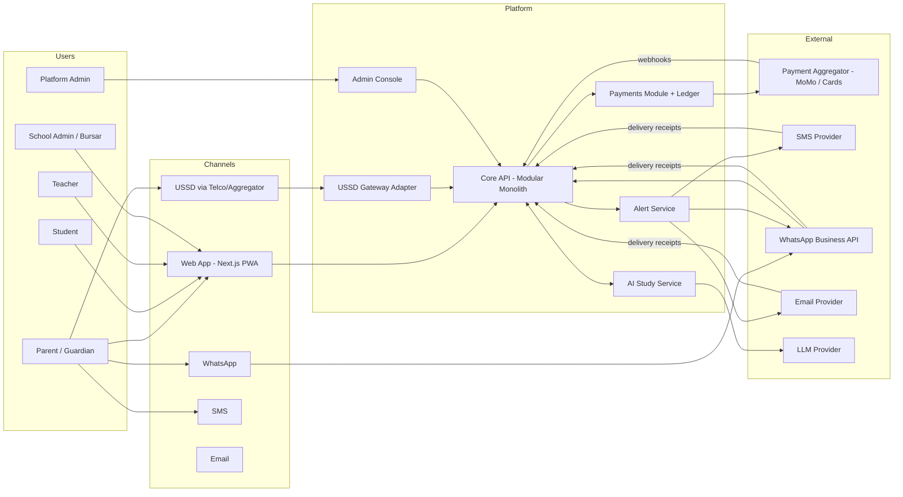
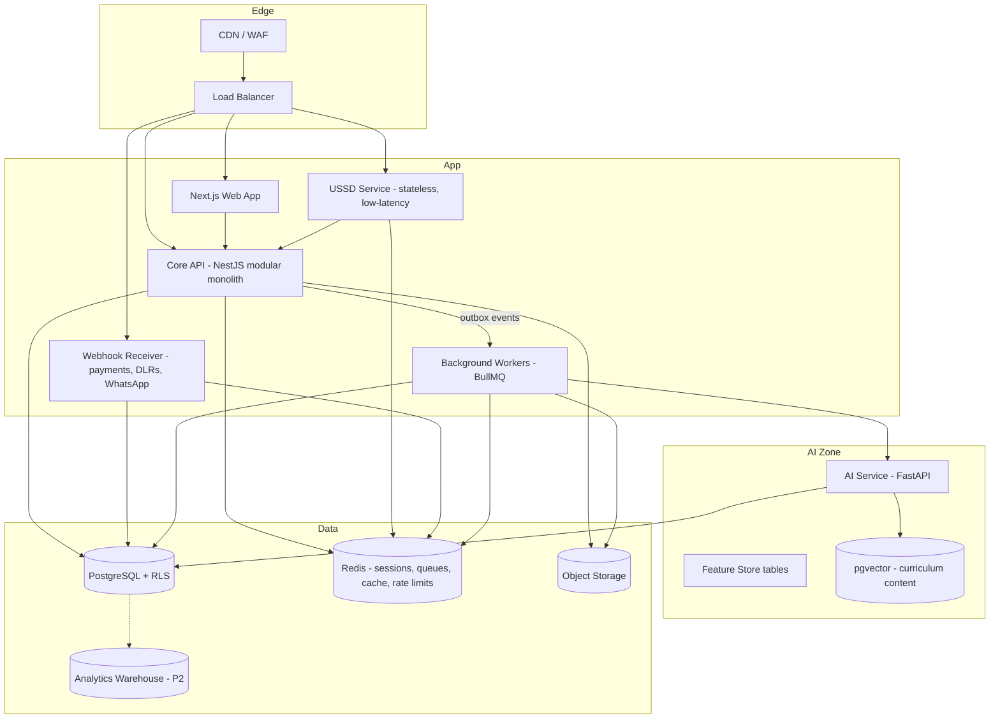
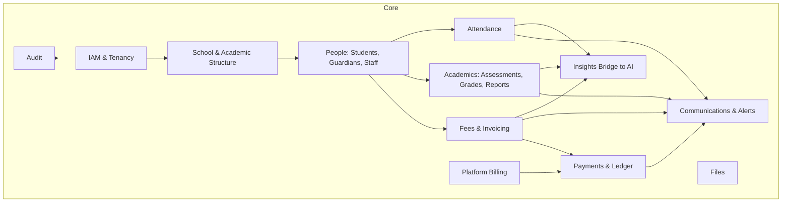
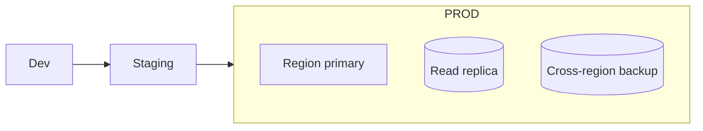

# 03 — System Architecture

## 1. Guiding Principles

1. **Modular monolith first.** One deployable with strict module boundaries (own tables, public service interface, domain events). Split services only when scale or team structure demands it. Exceptions: the **AI service** and **USSD/webhook edge** are separate because their runtime and scaling profiles differ.
2. **Multi-tenant by default.** Shared database, shared schema, `school_id` on every tenant table, enforced by Postgres Row-Level Security (see [ADR-002](adr/002-multi-tenancy-shared-schema-rls.md)).
3. **Events over cross-module calls.** Domain events (outbox pattern) trigger alerts, AI feature updates and analytics without coupling.
4. **Money is a ledger.** No balance is ever a mutable number; balances derive from immutable double-entry postings.
5. **Provider-agnostic edges.** Payments, SMS, WhatsApp, email, USSD aggregators are all behind ports/adapters so a provider swap is config + adapter, not rewrite.
6. **Design for flaky networks.** USSD sessions die, webhooks arrive twice or out of order, SMS delivery receipts are late. Everything is idempotent and reconciles.

## 2. Context Diagram

## 3. Container View

### Why USSD and Webhooks are separate processes
- USSD requires **sub-2s deterministic responses** and cannot share a thread pool with report generation.
- Payment/DLR webhooks need **always-on, minimal-logic** endpoints that persist the raw event first, acknowledge fast, process async.

Both still use the same codebase packages (shared domain library) to avoid divergent logic.

## 4. Module Map (Core API)

Rules:
- A module owns its tables; others access it only through its service interface or via events.
- Cross-module reads for reporting go through read models/views, never joins into another module's private tables from write paths.
- Lint rule (e.g. dependency-cruiser/Nx boundaries) enforces module boundaries in CI.

## 5. Multi-Tenancy

| Concern | Decision |
|---------|----------|
| Isolation | Shared DB, `school_id` column, **RLS policies** + app-level tenant context set per request (`SET LOCAL app.school_id`) |
| Tenant resolution | Web: subdomain (`greenhill.<domain>`) or path; USSD: shortcode extension or MSISDN lookup; API: JWT claim |
| Large-tenant escape hatch | Ability to move a school to a dedicated database (schema is portable; routing layer abstracts DSN) |
| Per-tenant config | `school_settings` JSONB + typed config service + feature flags |
| Branding | Logo/colours/templates per tenant, stored and cached |
| Backups/restore | Platform-wide PITR; per-tenant export tool for restore/escrow requests |
| Noisy neighbour | Per-tenant rate limits, queue fairness, alert throttles |

## 6. Cross-Cutting Architecture

### 6.1 Outbox & Domain Events
All state changes that trigger side effects write to an `outbox` table in the same DB transaction; a relay publishes to the queue. Consumers are idempotent (event ID dedup table).

Key events: `payment.succeeded`, `invoice.issued`, `invoice.overdue`, `grades.published`, `grade.corrected`, `attendance.marked`, `student.enrolled`, `guardian.linked`, `alert.delivered`, `insight.generated`.

### 6.2 Idempotency
`Idempotency-Key` header on mutating public endpoints; provider references (`provider_txn_id`) uniquely indexed; ledger postings unique per `(source_type, source_id, posting_type)`.

### 6.3 Caching
Redis: USSD sessions (TTL 120s), tenant config, rate limiting counters, short-lived OTPs. Never cache money balances without version stamps.

### 6.4 Background Jobs
BullMQ queues: `alerts`, `alerts-priority`, `reports`, `imports`, `reconciliation`, `insights`, `billing`. Separate worker pools; priority queue for OTPs and payment receipts.

### 6.5 Observability
Structured logs with `request_id`, `school_id`, `user_id`, `session_id`; OpenTelemetry traces; metrics for payment success, USSD latency, alert delivery, queue depth; alerts to on-call. Business SLO dashboards (payment success rate by channel/provider).

The topology, health model and critical paths built on these signals are specified in [16 — Service Map & Observability](16-service-map-observability.md) and [ADR-007](adr/007-service-health-model.md); the Platform Admin **Service map** screen is their UI.

### 6.6 Resilience
- Circuit breakers + timeouts on every external call.
- Provider failover: SMS (primary → secondary), payments (single aggregator at start, abstracted).
- Dead-letter queues with replay tooling.
- Reconciliation job as the safety net for lost webhooks.

## 7. Deployment Topology

- **Environments:** local (Docker Compose), staging (mirrors prod, sandbox providers), production.
- **Infra-as-code:** Terraform; containers on managed service (ECS/Fargate, Cloud Run, or Fly) — choice in [12](12-tech-stack-infra.md).
- **Release:** trunk-based, CI → staging auto, prod via approval; DB migrations backward-compatible (expand/contract).
- **Zero-downtime:** rolling deploys; USSD service deployed with connection draining, never mid-session kills.

## 8. Integration Boundaries

| Integration | Direction | Pattern | Failure handling |
|-------------|-----------|---------|------------------|
| Payment aggregator | Out: initiate; In: webhook | Port/adapter, signed webhook, status-check API | Poll status after timeout; reconcile daily |
| USSD aggregator/telco | In: session callbacks | Sync HTTP, stateless handler + Redis session | Fast fail with graceful end screen |
| SMS provider | Out + DLR in | Adapter with priority list | Retry, fallback provider |
| WhatsApp Business API | Out + inbound webhooks | Template-based outbound, session replies | Fallback to SMS |
| Email provider | Out + bounce webhooks | Adapter | Suppress hard bounces |
| LLM provider | Out | Via AI service gateway, redaction, caching | Fallback model / canned content |
| Object storage | Out | Signed URLs | Retries |

## 9. Failure Modes (Top Ones)

| Failure | Impact | Mitigation |
|---------|--------|-----------|
| Payment webhook lost | Parent charged, school not credited | Status polling job + daily reconciliation + manual claim tool |
| Duplicate webhook | Double credit | Unique provider ref + idempotent posting |
| USSD session timeout mid-payment | Parent unsure of status | Payment continues via MoMo prompt; SMS confirms outcome |
| SMS provider down | Alerts delayed | Failover provider; priority for receipts/OTP |
| Tenant data leak via bug | Severe | RLS as defence in depth, automated cross-tenant tests in CI |
| LLM hallucination in parent message | Trust damage | Teacher approval gate, template-bound generation, grounded on structured data |
| Bulk SMS cost explosion | Financial | Credit wallets, confirmation of estimated cost, hard caps |
