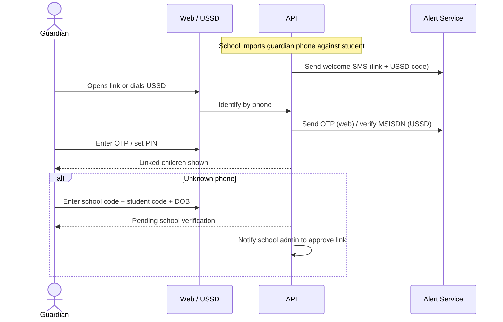
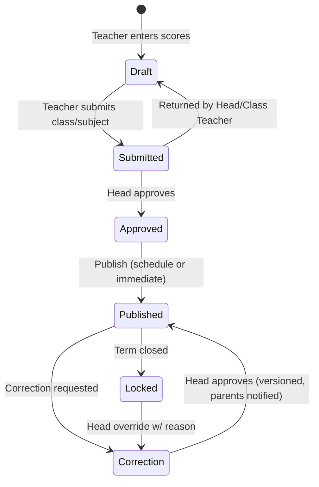
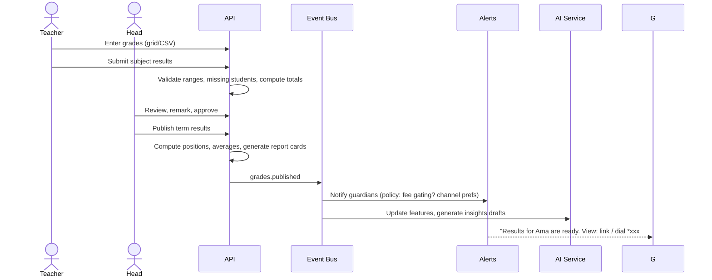
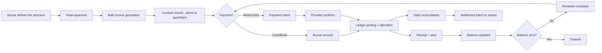
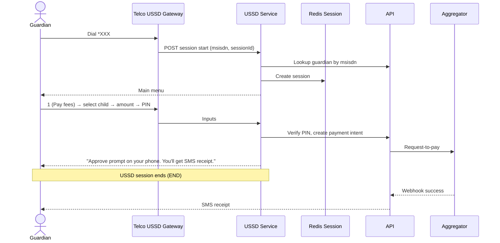
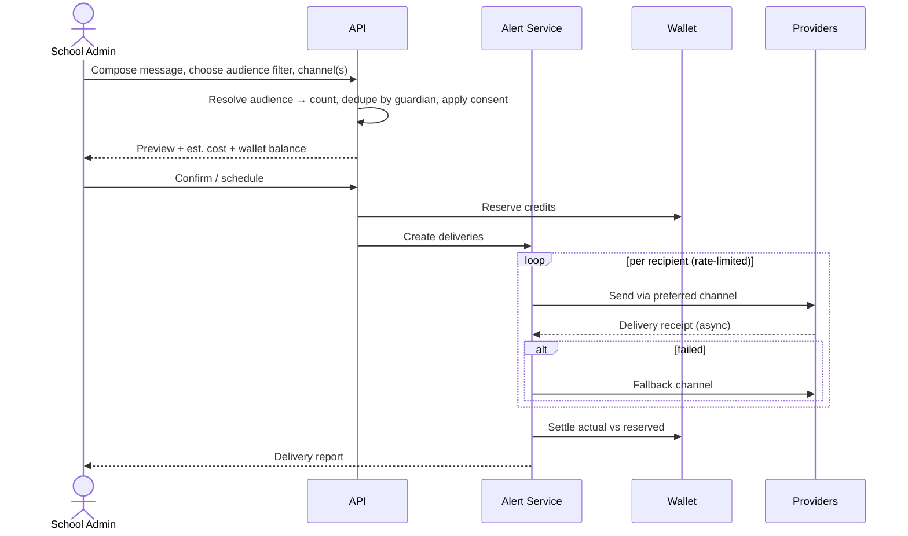
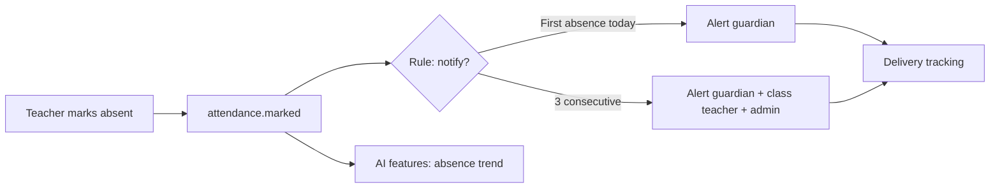
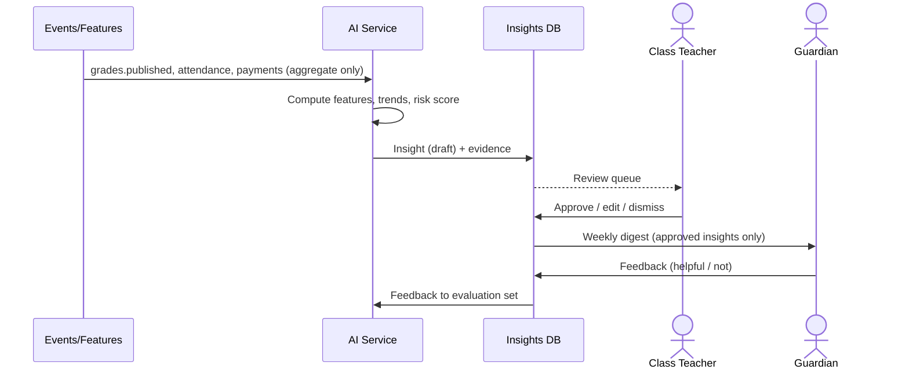
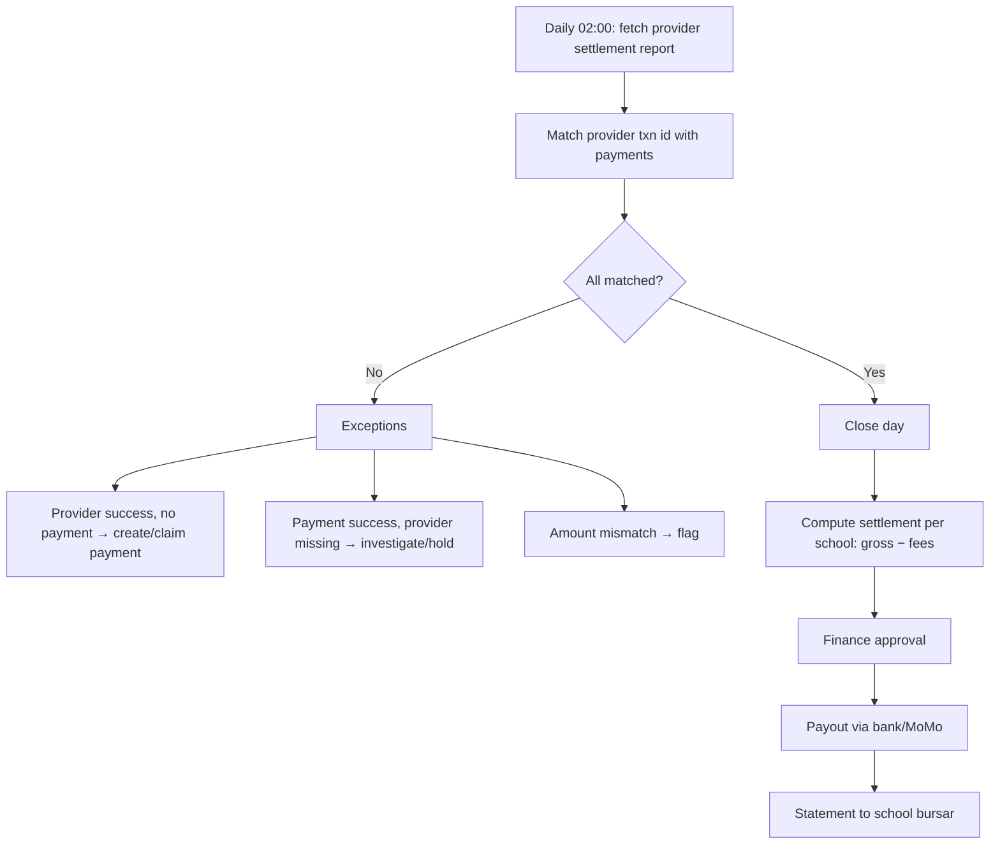
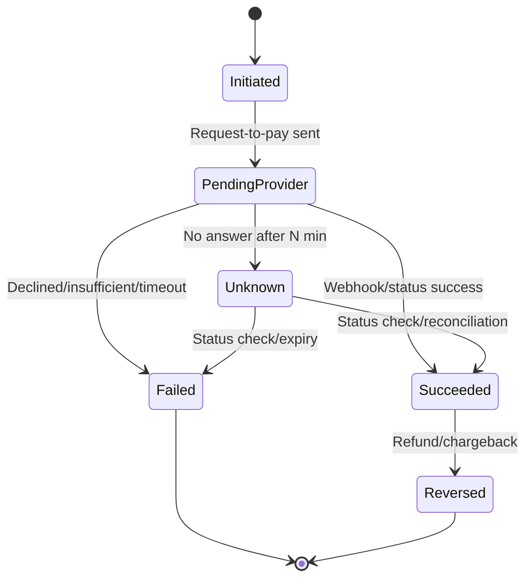

# 05 — Key Flows

All diagrams are Mermaid. State machines are normative; sequence diagrams show the happy path plus key failure branches.

## F1. School Onboarding

```mermaid
sequenceDiagram
  actor PA as Platform Admin
  actor SH as School Head
  participant API
  participant Jobs as Import/Verify Jobs
  PA->>API: Create school (name, country, plan, slug)
  API-->>SH: Invite email/SMS with setup link
  SH->>API: Set profile, logo, settlement account
  SH->>API: Configure terms, classes, subjects, grading scheme
  SH->>API: Upload students/guardians/staff CSV
  API->>Jobs: Validate (dry-run)
  Jobs-->>SH: Report: errors, duplicates, phones invalid
  SH->>API: Confirm import
  Jobs->>API: Create records, link guardians, normalise phones
  SH->>API: Define fee structures
  PA->>API: Verify settlement account (KYC)
  SH->>API: Invite staff; send guardian activation SMS
  API-->>PA: Checklist complete → Go-live
```

Onboarding checklist states: `profile → structure → people → fees → payments_verified → comms_ready → live`.

## F2. Guardian Activation & Linking



Rules: a link stays `pending` until a school user approves or the phone matches an imported record. Changing a primary guardian phone requires OTP on the old number or school approval.

## F3. Grade Lifecycle





## F4. Fee Cycle



Reminder schedule (default, configurable): 7 days before due, due day, +3, +7, +14 (escalate to Admin list). Quiet hours respected.

## F5. Payment via Web (MoMo)

```mermaid
sequenceDiagram
  actor G as Guardian
  participant W as Web App
  participant API
  participant PAY as Payments Module
  participant AG as Aggregator
  participant MNO as Mobile Money
  participant AL as Alerts
  G->>W: Choose child, items/amount, MoMo number
  W->>API: POST /payment-intents (Idempotency-Key)
  API->>PAY: Validate balance, create intent (pending)
  PAY->>AG: Request-to-pay (msisdn, amount, ref)
  AG->>MNO: Push approval prompt
  MNO-->>G: "Approve GHS 500 to GreenHill?" + PIN
  G->>MNO: Enters MoMo PIN
  MNO-->>AG: Success
  AG-->>API: Webhook (signed) payment.success
  API->>API: Persist raw event, verify signature, idempotent dedupe
  API->>PAY: Post ledger, allocate, mark invoice
  PAY->>AL: payment.succeeded
  AL-->>G: Receipt SMS/WhatsApp
  W-->>G: Poll/SSE shows success
  Note over API,AG: If no webhook in N minutes → status-check API; else mark expired/unknown for reconciliation
```

## F6. Payment via USSD



Design choice: USSD never waits on the payment result inside the session; it hands off to the MoMo approval prompt and confirms by SMS, because sessions expire quickly.

## F7. Announcement / Bulk Message



## F8. Absence Alert



## F9. AI Insight Loop



## F10. Reconciliation & Settlement



## F11. Payment State Machine



## F12. Student Year-End Rollover

1. Close term/year → lock grades.
2. Promotion rules (per level) → proposed list; Head reviews exceptions (repeat/withdraw).
3. Create next-year enrolments; carry forward arrears as opening balance line (policy).
4. Archive graduates; retain read-only access for transcripts.
