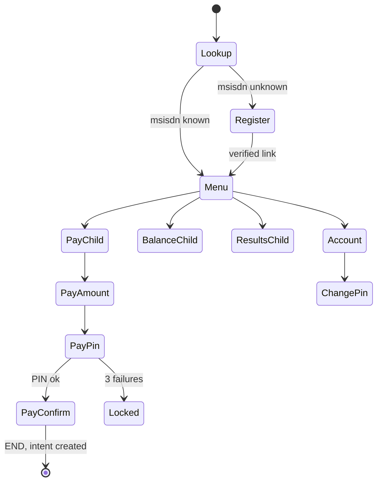

# 06 — USSD Specification

## 1. Constraints That Shape Everything

| Constraint | Typical value | Design response |
|-----------|---------------|-----------------|
| Screen length | ~160–182 chars (varies by network) | Hard cap each screen at **160 chars**; test on each telco |
| Session timeout | 30–120 s idle; ~180 s total on some networks | Keep flows ≤ 5 steps; no long operations in-session |
| Response SLA | Gateway timeout ~ 3–5 s | Target < 1.5 s p95; no synchronous calls to slow external APIs |
| No rich input | Numeric/text only | Number menus, short codes, `0` Back, `00` Home |
| Identity | MSISDN asserted by network | Use as identity, add **PIN** for money/sensitive actions |
| Cost | Charged per session to provider/aggregator | Keep flows short, avoid chatty loops |
| Stateless HTTP | Gateway calls our endpoint each keypress | State in Redis keyed by `sessionId` |

## 2. Access Model

- **Shared shortcode** (e.g. `*714#`) with MSISDN lookup — the guardian's phone identifies their children across schools. Preferred; no per-school shortcode cost.
- **School extension** (e.g. `*714*123#`) lets a school brand its own entry and route unknown numbers to the right school registration. Optional.
- Provider/aggregator candidates: direct telco (MTN/Telecel/AT), or aggregators (Hubtel, Africa's Talking, Arkesel, etc.). Shortcode procurement takes **weeks** — start early (see [14](14-risks-open-questions.md)).

## 3. Gateway Contract (generic)

Providers differ; the adapter normalises to:

```json
// inbound (from gateway)
{ "sessionId": "abc123", "msisdn": "+233241234567", "network": "MTN",
  "input": "1", "serviceCode": "*714#", "type": "initiation|response|release" }

// outbound
{ "message": "CON Welcome...\n1. Pay fees\n2. Results", "type": "CON|END" }
```

Rules:
- `CON` = continue session, `END` = terminate.
- Handler is **stateless**: loads session from Redis, applies input, saves new state, renders screen.
- Every input processed idempotently: store `lastInputSeq`; if the gateway retries, return the last rendered screen.
- Never log raw input at PIN steps.

## 4. Menu Tree

```
*714#
└─ Welcome [Language if first time] → PIN not needed for read-only menus
   1. Pay school fees
      └─ Select child (if >1)
         └─ Select school (if guardian has kids in >1 school)
            └─ Balance: GHS 1,200.00 (due 15 Nov)
               1. Pay full (1,200)
               2. Pay part (enter amount)
               3. Pay specific item
               0. Back
               └─ Choose MoMo number: 1. This number  2. Other number
                  └─ Enter PIN
                     └─ Confirm: "Pay GHS 500 for Ama (GreenHill). 1.Confirm 2.Cancel"
                        └─ END: "Approve prompt on your phone. SMS receipt follows."
   2. Check balance
      └─ Select child → summary: total, paid, due, last payment
   3. Results
      └─ Select child → latest term summary: avg, position, top/bottom subject
         1. Send full results by SMS/WhatsApp link
   4. Attendance
      └─ Select child → this term: Present 52/55, last absent: 14 Oct
   5. My account
      1. Change PIN
      2. Language
      3. Alert preferences
      4. Link another child
      5. Update MoMo number
   0. Exit
```

Global keys: `0` Back, `00` Home, `*` handled by telcos in some networks — avoid relying on it.

## 5. Sample Screens (≤160 chars)

```
Welcome to EsmPay
GreenHill Academy
1. Pay fees
2. Balance
3. Results
4. Attendance
5. My account
```

```
Select child
1. Ama Mensah (JHS2)
2. Kofi Mensah (P5)
0. Back
```

```
Ama: Due GHS 1,200
1. Pay all
2. Pay part
3. Pay by item
0. Back
```

```
Enter 4-digit PIN to
pay GHS 500 for Ama
```

```
Pay GHS 500 to
GreenHill for Ama?
1. Confirm
2. Cancel
```

```
Request sent. Approve
on your phone with MoMo
PIN. SMS receipt follows.
```

## 6. State Machine



## 7. Registration of Unknown Numbers

1. "Number not registered. 1. Link my child 2. Exit"
2. Enter school code (6 digits shown on fee notice).
3. Enter student code.
4. Enter child's date of birth (DDMMYY) — second factor.
5. Create `pending` link → school notified; SMS to the number when approved. Rate-limited (3 attempts/day/msisdn) to prevent enumeration.

## 8. PIN Policy

- First use: guardian sets 4-digit PIN (reject 1234/0000/repeated).
- Stored salted+peppered hash; never in logs.
- 3 wrong tries → lock 30 min + SMS alert; reset via web OTP or school-assisted.
- PIN required for: pay, change MoMo number, link child, view results (configurable), change PIN.
- Read-only menus (balance) may skip PIN — school-level toggle.

## 9. Payment Handoff Rules

1. USSD creates `payment_intent` with `channel=ussd`, `idempotency_key = sessionId+step`.
2. Aggregator **request-to-pay** to chosen MoMo number (push prompt).
3. Session ends with "approve on your phone".
4. Outcome by webhook → receipt SMS; failure → SMS with retry instruction.
5. Alternative path (aggregator-specific): **direct USSD payment** where the telco handles PIN within session — adapter supports both.
6. Daily and per-transaction limits configured per school/guardian; high-value requires confirmation SMS.

## 10. Error Handling & Copy

| Situation | Screen | Action |
|-----------|--------|--------|
| Invalid option | "Invalid choice. Try again." + redisplay menu | Max 3 then END |
| System error | END "Service busy. Please try again shortly." | Log, alert if rate > threshold |
| Session expired | New dial restarts; if mid-payment, check intent status first and tell user | Avoid double charging |
| Pending intent exists | "You have a payment pending. 1. Check status 2. Start new" | Prevent duplicates |
| Insufficient MoMo balance | Appears via SMS from telco; our SMS follows | Retry link |
| Child has no invoice | "No fees due for Ama. Thank you!" | |
| Amount out of range | "Min GHS 1. Max balance GHS 1,200." | Re-prompt |

## 11. Localisation

- Message catalogue keyed by `ussd.<screen>.<variant>` per locale; character-count tests in CI for every locale (some scripts expand length).
- Language chosen on first session; saved on guardian; override from My Account.
- Numbers/dates formatted per locale; currency symbol short (`GHS`).

## 12. Security

- Don't expose full names/amount history without PIN if configured (SIM swap risk).
- Detect SIM swap events if the telco offers an API (or via recent MSISDN-IMSI change signals) → force PIN reset.
- Rate-limit by MSISDN and by gateway source IP; verify gateway IP allowlist/shared secret.
- No PII in server logs beyond hashed msisdn.

## 13. Observability

Metrics: sessions/min, completion rate per flow, drop-off per step, latency p50/p95, payment initiation success, errors by network. Alert on latency > 2 s p95 or error rate > 2%.

## 14. Testing

- Simulator (local web UI) mimicking gateway contract, with network-specific limits.
- Automated flow tests: happy paths, back/home, timeout resume, double-submit, 3 wrong PINs.
- Real-device UAT on each network before go-live, including low-end phones.
