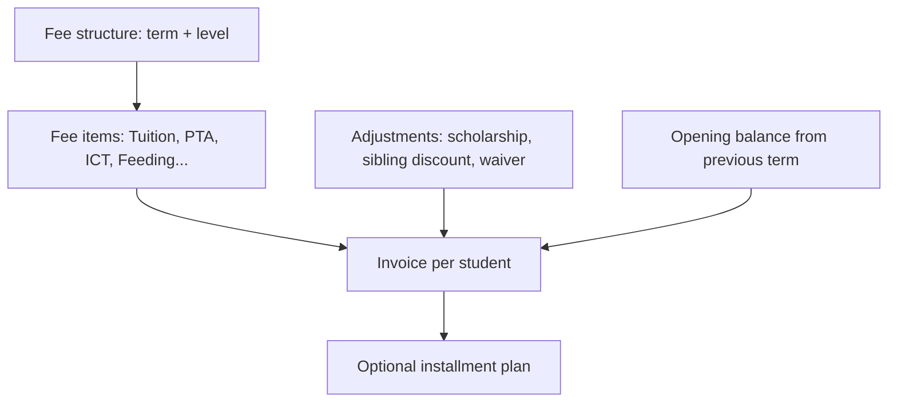

# 07 — Payments & Ledger

## 1. Goals

1. A parent can pay any amount toward any child's fees in under a minute on web or USSD.
2. Every payment is traceable from provider transaction → ledger → invoice → receipt → settlement.
3. School funds are accurate to the pesewa, reconcilable daily, and settled predictably.
4. The platform earns revenue transparently and survives provider glitches.

## 2. Payment Methods

| Method | Channels | Priority | Notes |
|--------|----------|----------|-------|
| Mobile money (MTN MoMo, Telecel Cash, AT Money) | Web, USSD, WhatsApp link | P0 | Request-to-pay (push prompt) |
| Card (Visa/Mastercard) | Web | P1 | Hosted checkout; no card data touches our servers (PCI SAQ-A) |
| Bank transfer / virtual account per school or student | Web instructions | P1 | Auto-match via reference |
| Cash / cheque at bursar | School counter | P0 | Manual entry with receipt, audit, maker-checker for voids |
| Pay link / QR | Share via SMS/WhatsApp | P1 | Pre-filled intent for relatives |

## 3. Aggregator Strategy

- Start with **one aggregator** that supports: MoMo collections across the major networks, split/sub-merchant settlement, webhooks, status-check API, and a sandbox. Candidates to evaluate: Hubtel, Paystack, Flutterwave, ExpressPay, Kora, Moolre (confirm current coverage, fees, settlement terms, KYC burden).
- Wrap in a `PaymentProvider` port:

```ts
interface PaymentProvider {
  requestToPay(input: { msisdn; amount; currency; reference; callbackUrl; metadata }): Promise<ProviderRef>;
  checkStatus(ref: ProviderRef): Promise<PaymentStatus>;
  verifyWebhook(headers, rawBody): VerifiedEvent;
  refund?(ref, amount): Promise<RefundRef>;
  getSettlementReport(date): Promise<ProviderTxn[]>;
  createSubMerchant?(school): Promise<SubMerchantRef>;
}
```

- **Funds flow decision (critical):** see [ADR-004](adr/004-funds-flow-and-settlement.md). Recommended: **aggregator sub-merchant per school with split settlement** so funds go directly to the school and our commission is split off, which avoids us holding customer money (reducing regulatory exposure). Fallback: platform collects into a merchant account and pays out (requires stronger licensing/compliance).

## 4. Fee Structures & Invoicing



Rules:
- Invoice total = Σ items − adjustments + opening balance + penalties.
- Items may be optional (uniform, transport) and chosen per student.
- Discounts have reasons and approver; applied before issuing.
- Late fees optional per school, computed by scheduled job, posted as separate lines (never silently).
- Invoice numbers sequential per school per year (`GHA-2026-000123`) — gap-free where required by law.

## 5. Allocation Rules

When a payment arrives:
1. If the intent targeted specific invoice/items → allocate there.
2. Otherwise allocate to **oldest outstanding invoice first**, mandatory items before optional ones.
3. Overpayment → credit balance (`student_credit`) applied to next invoice or refunded.
4. Family payment (multiple kids) → split per intent breakdown; USSD default: single child at a time.

## 6. Ledger (summary — details in [04](04-data-model.md))

Posting on success of GHS 500 payment, provider fee 1.0% (GHS 5.00) borne by [school/parent — configurable], platform fee 0.5% (GHS 2.50):

| Step | Debit | Credit | Amount |
|------|-------|--------|-------:|
| 1 Receipt | `provider_clearing` | `student_receivable` | 500.00 |
| 2 Provider fee | `school_payable` | `provider_fee_payable` | 5.00 |
| 3 Platform fee | `school_payable` | `platform_fee_revenue` | 2.50 |
| 4 Recognise school's net | (derived) `school_payable` = 500 − 5 − 2.50 = **492.50** | | |
| 5 Settlement | `school_payable` | `provider_clearing` / bank | 492.50 |

Fee-bearing options per school: **school absorbs** (default), **parent pays convenience fee** (shown clearly before confirmation), or **hybrid**. Parent-visible fees must be disclosed pre-confirmation on both web and USSD.

## 7. Intent → Payment Lifecycle

States (see state machine in [05](05-flows.md)): `initiated → pending_provider → succeeded | failed | unknown → reversed`.

Guarantees:
- **Idempotency**: intent creation keyed; webhook processing keyed on provider txn id; ledger posting unique on `(source, id, type)`.
- **Webhook-first, poll-second**: webhook stored raw, signature verified, processed async. A watcher polls `checkStatus` for intents pending > 2 min (backoff up to 30 min). After expiry, status stays `unknown` until reconciliation resolves it.
- **No success without verification**: success state set only from a verified webhook or direct provider status call, never from client redirects.
- **Amount check**: provider amount/currency must equal intent; mismatches go to exceptions.

## 8. Receipts

- Unique receipt number, school branding, payer, student, items paid, balance remaining, date, provider ref.
- Delivered via SMS (short link), WhatsApp (document template), email PDF; available in web history.
- Tamper-evident: QR/short URL verifying authenticity.

## 9. Reconciliation

Daily job per provider:
1. Pull provider settlement/transaction report for D-1.
2. Match on `provider_txn_id`, amount, status.
3. Classify: matched, missing-internal, missing-provider, amount-mismatch, status-mismatch.
4. Auto-resolve safe cases (e.g., internal pending but provider success → apply payment).
5. Surface the rest to Platform Finance with tooling: claim, adjust, refund, write-off (with approvals).
6. Daily invariant check: `Σ payments − fees − settlements = school_payable` per school.

## 10. Settlement

| Aspect | Default |
|--------|---------|
| Cycle | T+1 business day (configurable per school: daily/weekly) |
| Method | Direct from aggregator split to school's verified bank/MoMo account |
| Statement | Per payout: gross, fees, net, list of transactions, CSV/PDF |
| Holds | Disputed, unknown, or recently-onboarded schools (rolling reserve policy optional) |
| Verification | Settlement account name must match registered school (KYC) before first payout |

## 11. Refunds & Reversals

- Initiated by Bursar; **approved by Head** (maker-checker).
- Original method preferred; creates reversing ledger entries and invoice balance restoration.
- Receipt of refund sent to guardian; reason recorded.
- Chargebacks (cards) auto-create a hold and exception.

## 12. Limits & Risk Controls

| Control | Detail |
|---------|--------|
| Per-transaction & daily limits | Per guardian and per school; follow telco/regulatory caps |
| Velocity checks | Many attempts / many failures from one MSISDN or IP → temporary block |
| Duplicate protection | Warn if same payment amount/student within 5 min |
| Name verification | Show payer name returned by MoMo lookup where available |
| SIM swap risk | Force PIN re-verify on recent swap/change; cooling-off for new number |
| Fraud review | Rules + manual queue in Platform Finance |

## 13. Platform Revenue Model (options)

| Model | Description | Notes |
|-------|-------------|-------|
| Per-student per-term SaaS fee | Billed to school | Predictable |
| % transaction fee | Small cut on digital collections | Aligns with value; must be disclosed |
| Alert pass-through | SMS/WhatsApp at cost + margin via credit wallet | Avoid subsidising |
| Premium AI add-on | Per student | P1/P2 |

**Working assumption in the prototype** (pricing still open, see Q3/Q21–Q23): a hybrid of all four plus a per-session USSD charge — subscriptions (GHS 6/9/12 per student per term), 0.50% platform fee on digital collections, alert credits at a margin over provider cost, AI add-on GHS 2 per student per month. How these add up to gross profit and contribution, the ledger accounts they post to, and the owner's revenue dashboard are in [15 — Platform Revenue](15-platform-revenue.md). The "follow a payment" calculator in the prototype shows aggregator fee (1.00%), platform fee (0.50%) and school receipt, and lets you flip who bears the fee.

## 14. Compliance Notes (verify with counsel)

- Payment aggregator regulations and the **Bank of Ghana** payment systems rules; operate under the aggregator's licence instead of becoming a payment service provider unless deliberately pursuing a licence.
- KYC/AML on schools (business registration, TIN, account name match).
- Data protection for payer phone numbers (see [10](10-security-privacy.md)).
- E-levy / taxes on transfers: handle per current rules; show fees clearly; receipts to reflect VAT if applicable.
- Retention of financial records ≥ 7 years.

## 15. Test Strategy

- Provider sandbox contract tests (record/replay fixtures).
- Property tests on ledger invariants (random payment/refund sequences ⇒ balanced).
- Chaos tests: duplicate/out-of-order/late webhooks, provider timeouts, partial outages.
- Reconciliation tests with seeded discrepancies.
