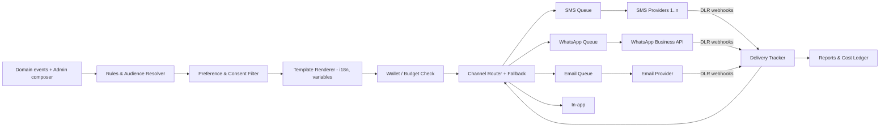
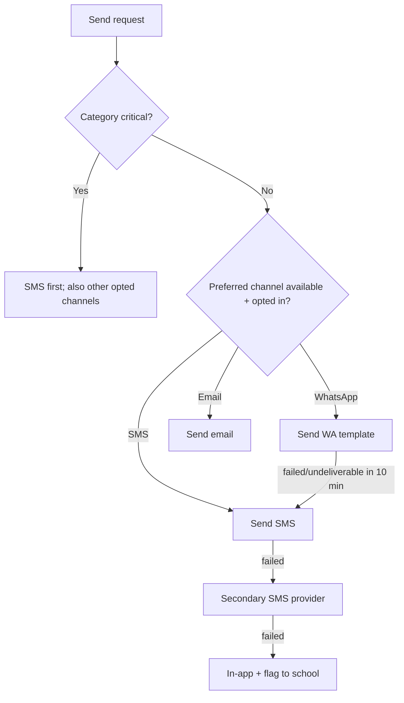
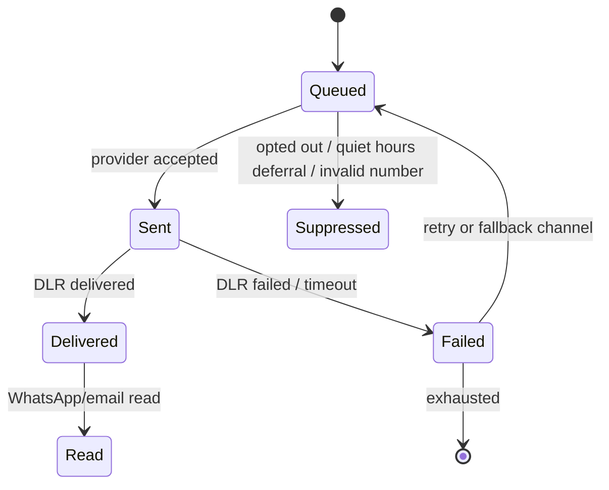

# 08 — Alert System (Email · SMS · WhatsApp)

## 1. Goals

- One API for every notification in the platform; channel details hidden from modules.
- Right message → right person → right channel → right time, with cost control.
- Reliable and auditable: know what was sent, delivered, read, or failed.

## 2. Architecture



Components:
| Component | Responsibility |
|-----------|---------------|
| **Audience resolver** | Turns filters (class, level, arrears > X, all guardians, specific students) into de-duplicated recipients |
| **Preference filter** | Applies consent, opt-outs, category prefs, quiet hours, locale |
| **Template renderer** | Merge fields, locale selection, length/segment calculation for SMS |
| **Router** | Chooses channel by policy; applies fallback chain |
| **Provider adapters** | Uniform `send()`/`parseDLR()` per provider |
| **Delivery tracker** | State machine per delivery; retries; webhooks |
| **Wallet** | Per-school credit balance; reservations; top-ups |

## 3. Message Categories

| Category | Examples | Default channels | Can guardian opt out? | Priority |
|----------|----------|------------------|-----------------------|----------|
| **Security** | OTP, PIN lock, new device | SMS (WhatsApp if opted in) | No | Critical |
| **Transactional – payment** | Receipt, failed payment, refund | SMS + WhatsApp + email | No (receipts) | High |
| **Fees** | Invoice issued, due, overdue | SMS → WhatsApp | Partial (frequency) | Normal |
| **Academic** | Results published, low grade, assignment | WhatsApp/SMS + in-app | Partial | Normal |
| **Attendance** | Absent/late | SMS/WhatsApp | Partial | High |
| **Announcement** | Events, closure, PTA | SMS/WhatsApp/email | Yes (non-urgent) | Normal |
| **Emergency** | Closure, safety | All channels | No | Critical – bypass quiet hours |
| **AI digest** | Weekly progress summary | WhatsApp/email/in-app | Yes | Low |
| **Staff** | Admin → teachers | WhatsApp/email/in-app | Limited | Normal |

## 4. Channel Policies

### SMS
- Sender ID per school where allowed (register alphanumeric sender IDs with telcos — lead time!).
- Segment-aware: GSM-7 160 chars, UCS-2 70 chars (local scripts/emoji double the cost) — show estimated segments in composer.
- Short links (own domain) with tracking; avoid blacklisted shorteners.
- DND/opt-out: STOP handling where required.
- Multiple providers with priority, health checks, and automatic failover.

### WhatsApp (Business Platform / Cloud API)
- **Template messages** required for business-initiated messages outside the 24-hour window; templates must be pre-approved per language.
- Categories: Utility (receipts, results), Authentication (OTP), Marketing (avoid) — pricing differs by category.
- Requires **explicit opt-in** captured at registration/first USSD or web visit and stored in `consents`.
- Inbound messages open a 24-hour service window → bot can answer (balance, pay link, results).
- One WhatsApp Business account for the platform (shared number, school name in message) at first; per-school number is P2 (cost/verification).

### Email
- Domain authentication (SPF/DKIM/DMARC), per-school display name, `reply-to` set to school.
- Used for PDFs (report cards, statements), digests, staff comms; bounce/complaint suppression.

### In-app
- Inbox + badge; always written, zero cost; web push for PWA.

## 5. Routing & Fallback Logic



- Policy per category in `routing_policies` (platform default; school override within limits).
- Cost-aware: if WhatsApp utility cost < SMS cost for that recipient/country, prefer it.
- Dedup: one guardian with 3 children in one school gets **one** combined message where sensible ("Results ready for Ama and Kofi").

## 6. Delivery State Machine



Retries: exponential backoff, max 3 per channel; never retry permanent errors (invalid number, blocked).

## 7. Cost Control & Wallet

- Each school has an **alert wallet** (GHS credits). Platform sets unit prices per channel/segment + margin.
- Composer shows: recipients, segments, **estimated cost**, balance. Block send if insufficient (admin can top up via MoMo).
- Critical/transactional categories (OTP, receipts) may draw from a platform-funded allowance up to a plan limit.
- Budget alerts: 80%/100% of monthly budget; per-day caps to prevent runaway sends.
- Costs recorded per delivery for margin analytics.

## 8. Compliance & Anti-Abuse

- Consent stored with source, timestamp, channel; guardians can manage in web/USSD.
- Message throttling per tenant & per recipient (no more than N non-critical/day).
- Quiet hours default 21:00–06:00 recipient local time (except critical).
- Content moderation on admin-written broadcasts (profanity/link/phish checks) to prevent platform abuse.
- Children's information in messages kept minimal (first name only; no grades in SMS body by default — use "results ready" + secure link). Configurable by school with a warning.
- Opt-out/stop honoured within minutes across channels for non-essential categories.

## 9. Template Management

- Keys like `fees.invoice.issued`, `payment.receipt`, `attendance.absent`, `results.published`.
- Variables validated at save (missing variable = send blocked).
- Locales: `en`, plus Twi/Ewe/Ga/Hausa etc.; fallback chain `locale → en`.
- WhatsApp template status sync (draft → submitted → approved/rejected) from the provider.
- Version history; school overrides only for allowed categories.

Example (SMS, en):
```
GreenHill: Receipt {{receipt_no}}. GHS {{amount}} received for {{student_first_name}}. Balance GHS {{balance}}. Thank you. {{short_link}}
```

## 10. System-Triggered Alerts (default rules)

| Trigger | Recipient | Timing |
|---------|-----------|--------|
| `payment.succeeded` | Payer + primary guardian | Immediate |
| `payment.failed` | Payer | Immediate |
| `invoice.issued` | Guardians | On issue |
| Invoice reminders | Guardians | −7d, 0d, +3d, +7d, +14d |
| `grades.published` | Guardians | On publish (staggered) |
| `grade.corrected` | Guardians | Immediate |
| Absence | Guardian | Same day by 10:00 / on mark |
| 3+ consecutive absences | Guardian, class teacher, admin | Daily check |
| AI risk flag approved | Guardian (+ teacher) | After approval |
| Weekly AI digest | Guardians | Weekly (configurable) |
| `login.new_device` | User | Immediate |
| Wallet low | School admin/bursar | Threshold |

## 11. Admin Experience (Composer)

1. Choose **audience**: all parents, by class/level, arrears over X, custom list, all teachers, specific staff.
2. Write message / choose template; preview in each locale/channel.
3. See **recipient count, segments, cost, wallet**.
4. Send now or schedule; confirm.
5. Track **delivered/failed/read** live; export failures; one-click resend via fallback.

## 12. Metrics

Delivery rate by channel/provider/network, time-to-deliver, opt-out rate, cost per delivered message, fallback rate, WhatsApp template rejection rate, queue lag. Alert on delivery rate drop > 10% in 15 min.
