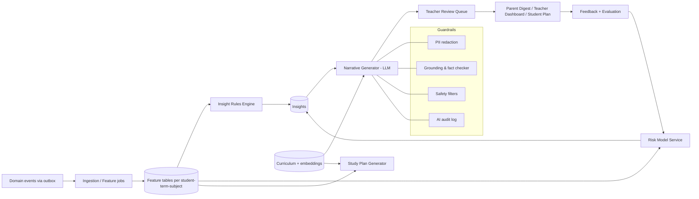

# 09 — AI Study Engine

## 1. Purpose

Turn the data schools already generate (grades, attendance, assessments) into:
1. **Understanding** — where each child stands and where they're heading.
2. **Early warning** — spot slipping students while there is still time.
3. **Action** — personalised study plans, practice, and teacher interventions.
4. **Communication** — plain-language progress updates to parents, in their language.

The AI is an **assistant to teachers and parents**, not an authority. It never replaces teacher judgement, and nothing reaches a parent that is not grounded in recorded data.

## 2. Capability Ladder

| Level | Capability | Technique | Phase |
|-------|-----------|-----------|-------|
| L0 | Descriptive analytics: averages, trends, rank, attendance rate | SQL/rules | MVP+ |
| L1 | Insight rules: "dropped 15% in Maths", "3 absences this week" | Deterministic rules + thresholds | P1 |
| L2 | Risk prediction: probability of failing term/subject | Gradient boosting / logistic regression (explainable) | P1 |
| L3 | Narrative generation: parent digest, teacher summary | LLM, grounded on structured facts | P1 |
| L4 | Personalised study plans & practice sets | Rules + LLM + curriculum retrieval | P1/P2 |
| L5 | Student tutor chat | LLM + RAG on curriculum, guardrails | P2 |
| L6 | Adaptive learning (mastery tracking, spaced repetition) | Knowledge tracing (BKT/DKT-lite) | P2 |

**Principle:** build L0–L1 first. They deliver most value, are cheap, and are explainable; they also produce the labelled data needed for L2.

## 3. Data Inputs

| Source | Used for | Notes |
|--------|----------|-------|
| Grades & assessments | Mastery, trend, volatility, peer-relative standing | Per subject/topic where tagged |
| Attendance | Absence streaks, late patterns | Correlates with performance |
| Teacher notes (shareable) | Context, strengths | Opt-in text processing |
| Curriculum map (GES/WAEC topics) | Topic-level weaknesses, practice | Content licensing check |
| Practice attempts | Mastery, time, error patterns | Student tool usage |
| Fee status | **Not used for student-level prediction by default** | Avoid stigma/bias; aggregate only for school ops |

**Exclusions by design:** no use of fee arrears, family income, gender, ethnicity, religion or disability as predictive features (fairness). Document and test for proxy bias.

## 4. Architecture

- Python **FastAPI** service; reads via a read-only DB role and event stream; writes only to AI-owned tables (`student_features`, `insights`, `study_plans`, `ai_audit`).
- Scheduled jobs (nightly features, weekly digests) + event-driven updates after `grades.published` / attendance.
- LLM access only via an internal **AI gateway** (rate limits, cost caps per school, model routing, fallbacks, caching, logging).

## 5. Features Computed (examples)

| Feature | Definition |
|---------|-----------|
| `subject_avg_term` | Weighted mean across assessments |
| `subject_trend` | Slope of last N assessments (robust regression) |
| `volatility` | Std-dev of normalised scores |
| `relative_standing` | Percentile within class/level |
| `missing_assessments` | Count of unsubmitted/absent assessments |
| `attendance_rate_30d`, `absence_streak` | From attendance |
| `late_ratio` | Late arrivals / school days |
| `improvement_vs_last_term` | Δ in average / rank |
| `topic_mastery` | Per-topic accuracy (when tagged) |
| `engagement_score` | Student tool usage (P2) |

## 6. Insight Types

| Type | Example (internal) | Parent-facing wording (draft) | Audience |
|------|-------------------|-------------------------------|----------|
| Decline | Maths −18% over 3 tests | "Ama's Maths scores have dipped in recent tests. Short daily practice on fractions may help." | Parent + teacher |
| Strength | English top 10% | "Ama is doing very well in English." | Parent + student |
| Attendance | 4 absences in 2 weeks | "Ama has missed 4 days recently. Please let the school know if there's an issue." | Parent + class teacher |
| Risk | P(fail Maths) 0.72 | Teacher-only by default; parent version needs approval | Teacher |
| Improvement | +12% vs last term | "Great progress this term!" | Parent + student |
| Study plan | Weekly plan | Student plan view + parent summary | Student, parent |
| Class insight | 60% missed "ratios" | Teacher dashboard | Teacher/Head |

Every insight stores **evidence** (the numbers and assessments behind it) so it's explainable and verifiable.

## 7. Risk Model (L2) Notes

- Target: "term average below pass mark" or "drop ≥ X% next assessment cycle".
- Start with logistic regression/GBM with calibrated probabilities; feature importance (SHAP) for explanations.
- Cold start: use rules until ≥ 2 terms of data exist per school; pooled model across schools (with tenant-safe, de-identified training data and contractual rights) improves it.
- Evaluate by precision@k for at-risk students, calibration, and **fairness slices** (by class, gender, school type). Monitor drift each term.
- Model version recorded on every insight; shadow-mode before showing.

## 8. Narrative Generation (L3) — Safe by Construction

1. Insight facts (JSON) are the **only** input to the LLM, never raw free-form data.
2. Prompt instructs: use only provided facts; tone: supportive, concrete, non-judgmental; reading level ~Grade 6; ≤ 80 words; locale target.
3. **Fact checker:** post-generation validator ensures all numbers/subjects in output exist in input facts; failures → fallback to template text.
4. Template fallback for every insight type so the system works without the LLM.
5. Parent-facing messages pass the **teacher review queue** (P1 default on; schools can later auto-approve low-risk types such as praise).
6. Translations via LLM with a glossary; high-stakes (risk) messages human-checked in launch languages.

## 9. Study Plans & Practice (L4)

- Inputs: weak topics, upcoming assessments/exam dates, student's available hours (set by guardian), curriculum map.
- Output: weekly plan (e.g. 3 × 25 min sessions), each with topic, short explainer, 5–10 practice questions, worked solutions.
- Question sources: licensed/open past questions, teacher-contributed bank, and LLM-generated items **validated** (answer verification via independent solve + teacher spot checks) before use.
- Delivery: web app, printable PDF, or **SMS/WhatsApp** micro-quizzes for low-data households (P2).
- Spaced repetition: re-surface weak topics at increasing intervals.

## 10. Student Tutor (L5, P2) — Guardrails

| Risk | Control |
|------|---------|
| Wrong/hallucinated answers | RAG on curriculum content, "show working", confidence + "check with your teacher" for low confidence |
| Unsafe content / grooming risk | Strict child-safety filters; no open-ended personal chat; topic-bounded to school subjects; block PII sharing |
| Cheating on assessments | Not enabled during exam windows (school toggle); explains rather than gives final answers for graded work |
| Over-reliance | Encourages attempts first; hint ladder |
| Privacy | No student identifiers sent to LLM; pseudonymous session IDs |
| Moderation | Logs reviewed via sampling; flagged sessions notify the school's safeguarding lead |
| Age | Under-13 access via guardian-consented school accounts only |

## 11. Privacy & Compliance for AI

- Lawful basis and **guardian consent** for AI processing documented per school; opt-out supported without penalty.
- PII minimisation: send LLM only first name placeholder (`{student}`) and aggregate numbers; substitute name after generation.
- Vendor controls: LLM provider with zero-retention/no-training terms (DPA); data residency evaluated.
- Explainability: every parent/teacher-visible insight has "Why am I seeing this?" showing evidence.
- Human oversight: teachers can dismiss/edit; dismissals feed back as negative labels.
- Auditable: `ai_audit` stores prompt hash, model, redaction list, output hash, validator result.

## 12. Evaluation & Quality

| Layer | Metric | Method |
|-------|--------|--------|
| Rules | Precision of flags (teacher agrees) | Teacher feedback buttons |
| Risk model | AUC, calibration, precision@k, fairness gaps | Offline backtest by term; monitor |
| Narrative | Factual accuracy (validator pass), tone, readability | Automated + human sampling |
| Study plans | Completion rate, subsequent score change | A/B (with consent) |
| Parent value | Digest open/useful rate | In-product feedback |
| Cost | LLM cost per student per month | Budget cap per school |

Golden test sets for narrative prompts; regression run on each prompt/model change.

## 13. Cost & Performance

- Prefer deterministic computation; invoke LLM only for narrative/plan text; cache by `(insight_type, facts_hash, locale)`.
- Use smaller/cheaper models for narrative; larger only for tutoring.
- Per-school monthly AI budget; degrade to templates when exceeded.
- Batch digests off-peak.

## 14. Rollout Plan

1. **Shadow:** compute insights, show only to Head/teachers; collect agreement.
2. **Teacher-in-the-loop digests** to parents for pilot schools.
3. **Student study plans** (no chat) opt-in.
4. **Tutor** for a limited class/level pilot with safeguarding review.
5. Expand languages and channels (WhatsApp/SMS quizzes).

## 15. Open AI Questions

See [14](14-risks-open-questions.md): curriculum content licensing, LLM vendor and data residency, local language quality (Twi/Ewe/Ga/Hausa), consent mechanics for minors, and whether to train pooled models across schools.
