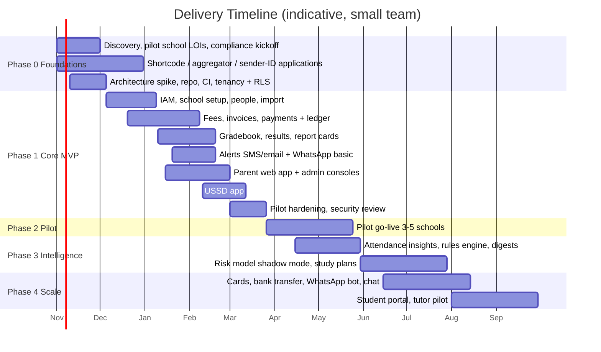

# 13 — Roadmap & MVP

## 1. MVP Definition

> **A pilot school can onboard its students and guardians, collect fees digitally via web and USSD with receipts and reconciliation, enter and publish grades, and message parents — safely and in a multi-tenant platform.**

MVP **includes**: tenancy/IAM, school setup, people & import, fees/invoices, payments (MoMo web + USSD + manual), receipts, reconciliation basics, gradebook + publish + report card, attendance, alerts (SMS + email; WhatsApp basic), parent web app, USSD (balance, pay, results), platform admin console, audit.

MVP **excludes**: AI beyond descriptive analytics, student portal, timetable, admissions, card payments, two-way chat, WhatsApp bot, tutor.

## 2. Phases

## 3. Phase Detail

### Phase 0 — Foundations (≈ 6–8 weeks, overlaps)
Goals: de-risk lead-time items and set the technical spine.
- Secure **2–3 pilot schools** (LOI), gather real fee sheets, report cards, grading schemes.
- Start **USSD shortcode**, **SMS sender ID**, **WhatsApp Business verification**, **payment aggregator onboarding/KYC** (long poles: weeks to months).
- Data Protection Commission registration; DPA/privacy notice drafts.
- Repo, CI, environments, tenancy + RLS + auth skeleton, design system, observability baseline.
- Decide ADRs 001–005.
- **Exit:** a logged-in user in tenant A cannot see tenant B (automated test); sandbox payment round-trip demo.

### Phase 1 — Core MVP (≈ 16–20 weeks)
Sequenced vertical slices; each ends demoable.
1. **Setup & people:** school profile, terms, classes, subjects, staff invite, CSV import, guardian links.
2. **Money:** fee structures → invoices → web MoMo payment → ledger → receipt → reconciliation → settlement report. Manual payments.
3. **Academics:** assessments, grade grid, workflow, report cards, publishing.
4. **Comms:** alert service core, templates, composer, delivery tracking, wallet.
5. **Parent app:** OTP login, children, balances/pay, results, attendance, notices.
6. **USSD:** shared code, lookup, balance, pay, results; simulator, UAT on all networks.
7. **Platform console:** schools, plans, providers, settlements, metrics, **revenue dashboard** ([15](15-platform-revenue.md)) and **service map with incident log** ([16](16-service-map-observability.md)). Revenue reporting views ship with the ledger work; the service map ships with the observability baseline in Phase 0/1 (probes and topology config first, then the UI).
- **Exit criteria:** pilot readiness checklist (see §5).

### Phase 2 — Pilot (≈ 8–12 weeks)
- Go live in 3–5 schools **across one full fee cycle and one results cycle**.
- Weekly feedback loops; metrics review; fix top friction (import quality, parent activation, USSD drop-offs).
- Finance operations dry-run: reconciliation + settlement every day with a human checker.
- **Exit:** ≥ 60% of fees digital in pilot schools; payment success ≥ 90%; no Sev1; NPS from bursars/heads ≥ 40.

### Phase 3 — Intelligence (≈ 12–16 weeks)
- Attendance + grade-driven rules insights (L1), teacher review queue, weekly parent digest (L3 narrative with fact checker).
- Risk model in **shadow mode**; evaluate precision and fairness; then expose to teachers.
- Study plans for opt-in students; printable + web.
- **Exit:** teacher agreement on flags ≥ 70%, digest open rate ≥ 50%, zero factual-error incidents.

### Phase 4 — Scale & Expand
- Card payments, bank transfer/virtual accounts, pay links.
- WhatsApp bot & two-way parent–teacher chat.
- Timetable, admissions, homework.
- Student portal + tutor pilot (after safeguarding review).
- Multi-country expansion kit (currencies, providers, locales, regulations).
- Public API/webhooks for school integrations; platform BI.
- Public status page; automated game-day incident drills; revenue forecasting and cohort analysis.

## 4. Team (suggested for MVP)

| Role | Count | Notes |
|------|-------|-------|
| Full-stack engineers (TS) | 3 | Web, API, payments |
| Backend/integrations engineer | 1 | USSD, providers, reliability |
| Product designer (UX, low-literacy/mobile-first) | 1 | Parent flows & USSD copy |
| Product manager / founder | 1 | School relationships, scope |
| QA / test automation | 0.5–1 | Payments & USSD critical |
| ML/data engineer | 0.5 (from Phase 3) | AI service |
| Ops/support & implementation | 1 | School onboarding and data import |

## 5. Pilot Readiness Checklist

- [ ] RLS cross-tenant tests green; permission matrix tests green
- [ ] Payments: sandbox + live small-value test across all 3 networks; reconciliation clean for 7 days in staging
- [ ] USSD UAT on MTN, Telecel, AT, on low-end devices; p95 < 2 s
- [ ] SMS sender ID approved; WhatsApp templates approved
- [ ] Backups restored in a drill; runbooks written; on-call set
- [ ] Privacy notice, consent flows, DPA signed with pilot schools
- [ ] Pen-test findings (critical/high) resolved
- [ ] Support process: WhatsApp support line, in-app help, bursar training done
- [ ] School data imported, verified by school, guardians activated (≥ 70% phone verified)

## 6. Key Milestones & Gates

| Gate | Condition |
|------|-----------|
| G0 Build start | Pilot LOIs, aggregator selected, ADRs 001–005 accepted |
| G1 Payments live (small) | Aggregator KYC complete, pen-test passed, finance runbook signed |
| G2 Pilot go-live | Readiness checklist complete |
| G3 AI to parents | Consent flows, review queue, fact-check validator, vendor DPA |
| G4 Scale | Pilot KPIs met, unit economics positive per school |

## 7. Backlog Seeds (first 20 tickets)

1. Monorepo scaffolding + CI + lint + test harness
2. Postgres schema bootstrap + RLS helpers + tenant context middleware
3. Cross-tenant isolation test suite
4. Users/memberships/OTP auth
5. Permission policy library + matrix tests
6. School, academic year, term, class, subject CRUD
7. Student/guardian CRUD + link verification
8. CSV import pipeline (validate → preview → commit)
9. Ledger package + invariants
10. Fee structure + invoice generation
11. Payment provider port + sandbox adapter
12. Webhook receiver with raw inbox + idempotent processing
13. Payment intent API + web checkout
14. Receipts + alert service MVP (SMS + email)
15. Reconciliation job + exceptions UI
16. Assessment + grade grid + workflow
17. Report card PDF
18. USSD simulator + session engine
19. USSD pay flow
20. Platform admin: school mgmt + provider config
